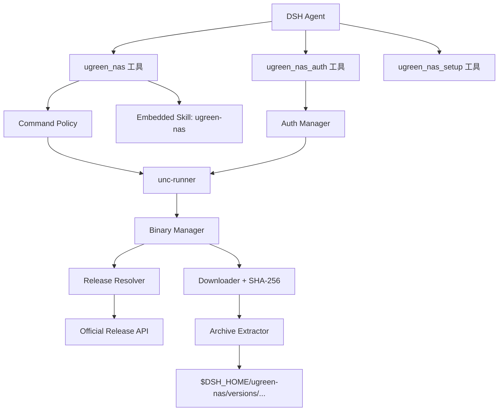

# DSH 绿联云插件设计

> 版本：0.1（设计稿）  
> 日期：2026-11-14  
> 状态：已实现；原始设计保留，当前行为以 [README.md](../README.md) 和 [AGENTS.md](../AGENTS.md) 为准  
> 关联文档：[README.md](../README.md) · [IMPLEMENTATION_PLAN.md](./IMPLEMENTATION_PLAN.md)  
> 实现差异：交付形态是 Host+Client bundle；登录由插件详情页收集登录方式、NAS 地址或 UGREENlink ID 与 token，Host 调用 `unc auth login`，不启动 `127.0.0.1` 网页登录。

## 1. 背景与证据

### 1.1 WorkBuddy 里的绿联云连接器

WorkBuddy 5.9.3 的绿联云连接器不是内置在 `app.asar` 中的代码，而是安装到用户目录的插件：

```text
~/.workbuddy/plugins/cache/workbuddy-connector-plugins-official/
└── ugreen-nas/
    └── 1.0.0-wb.1d83720d79cca5e7/
        ├── .codebuddy-plugin/plugin.json      1,488 B
        └── ai.workbuddy/
            ├── cli.json                      2,852 B
            └── assets/icon.png               5,453 B
```

市场副本位于：

```text
~/.workbuddy/plugins/marketplaces/
└── workbuddy-connector-plugins-official/connectors/ugreen-nas/
```

`settings.json:1022` 中该插件为 `false`，说明本机已安装但未启用；`installed_plugins.json:566-570` 记录了安装路径、安装时间和 `scope: "user"`。

`plugin.json` 的关键字段：

| 字段 | 值 |
|---|---|
| `name` | `ugreen-nas` |
| `$schema` | `https://agent-plugins.org/schemas/1.0.0/plugin.schema.json` |
| display name | 绿联云 / UGREEN Cloud |
| `policy.minWorkbuddyVersion` | `4.24.0` |
| `schemaVersion` | `1.0.0` |
| `keywords` | `["cli"]` |
| 缓存版本 | `1.0.0+wb.1d83720d79cca5e7` |
| 市场索引版本 | `1.0.0+wb.4046e5946500c9e2` |

`plugin.json` 没有 `author` 或 `license` 字段。公共 schema `https://agent-plugins.org/schemas/1.0.0/plugin.schema.json` 只要求 `$schema` 和 `name`，并允许 `extensions` 为自由对象；WorkBuddy 的 `cli.json` 契约不在公共 schema 内，属于 WorkBuddy 私有扩展。

### 1.2 `cli.json` 说明它不是 MCP

`cli.json` 的核心字段：

| 字段 | 行为 |
|---|---|
| `init.darwin` / `init.linux` | 下载 `https://file1-cn.ugnas.com/nas-cli/install.sh`，执行 `UNC_UPDATE_SHELL_RC=1 sh "$tmp"` |
| `init.win32` | 下载并执行 `install.ps1` |
| `auth` | `unc auth workbuddy --wait-timeout 5m` |
| `unAuth` | `unc auth logout` |
| `status` | `unc auth status --format json` |
| `statusMatch` | `"authenticated"\s*:\s*true` |
| `authUrlDomain` | `127.0.0.1` |
| `authWaitForExit` | `true` |
| `env.PATH` | 包含 `$HOME/.local/bin` |
| `versionCheck.command` | `unc version --format json` |
| `versionCheck.minVersion` | `0.1.56` |

`cli.json` 没有 MCP server 配置、没有命令、没有传输协议。WorkBuddy 在 ConnectorService 中把 `cli.json` 作为 CLI 连接器读取，代码常量包括 `Fl="cli.json"`、`jl="ai.workbuddy"`、`Rl=["skills","skill"]`，并通过 `isCliConnector(e){return e.type==='cli'}` 区分 CLI 与 MCP。`app.asar` 中检索 `ugreen`/`绿联` 没有命中，进一步说明它是市场安装的插件，不是内置连接器。

### 1.3 WorkBuddy 的连接器类型并不只有一种

WorkBuddy 产品层把所有集成都称为“连接器”，内部至少有三类：

| 类型 | 示例 | 文件形态 |
|---|---|---|
| 纯 MCP | `qq-mail`、`westock-mcp` | `plugin.json + mcp.json`，`keywords:["mcp","skills"]` |
| MCP + Skill + CLI 混合 | `zspace-nas` | `plugin.json + mcp.json + skills/* + ai.workbuddy/cli.json` |
| 纯 CLI | `ugreen-nas` | `plugin.json + ai.workbuddy/cli.json` |

因此“连接器就是 MCP”这个说法对 WorkBuddy 的部分连接器成立，但不适用于绿联云。绿联云的具体实现是 CLI 型连接器。

### 1.4 `unc` 二进制

当前安装的 `unc`：

```text
~/.local/bin/unc
version:     0.1.61
commit:      13f402b
build_time:  2026-11-02T09:44:58Z
格式:        17 MB Mach-O arm64
Go:          1.25.11
module:      gitlab.ugnas.com/ugos-pro/ai_tools/ugopencli
             v0.1.17-0.20261102094343-13f402be21fe
依赖:        grpc v1.83.2、protobuf v1.36.11、ugidl v1.15.7
```

`unc` 走绿联的 protobuf 开放 CLI 通道，默认输出 JSON。产品能力分组：

| 分组 | 子命令数 | 能力 |
|---|---:|---|
| `file` | 21 | 文件、目录、标签、配额、上传/下载 |
| `docker` | 14 | 容器、镜像、Compose、日志、启停 |
| `download` | 7 | 下载任务创建、查询、暂停、继续、重试、移除 |
| `storage` | 3 | 磁盘、存储池、存储卷、SMART |
| `app` | 9 | 应用中心查询、搜索、安装、更新、卸载、启停 |
| `search` | 4 | 按文件名全局搜索 |
| `ctl` | 4 | 用户、群组、硬件电源、系统版本 |
| `network` | 2 | 网关、DNS、代理、网卡 |
| `taskmgr` | 9 | CPU/GPU/内存/网络/硬盘负载、服务、进程 |
| 合计 | 73 | 覆盖 WorkBuddy 绿联云连接器的主要能力 |

`unc --help` 还提供 `auth`、`doctor`、`plugin`、`skill`、`upgrade`、`version`、`uninstall` 等管理命令。插件只应暴露业务命令；`plugin`、`skill`、`uninstall`、`upgrade` 应由插件自身管理，避免模型误操作宿主。

### 1.5 官方发布资产

`https://api.ugnas.com/api/system/v1/sa/unc/releases/latest` 当前返回：

```json
{
  "tag": "v0.1.61",
  "version": "0.1.61",
  "date": "2026-11-02",
  "prerelease": false,
  "assets": [
    "unc-v0.1.61-darwin-amd64.tar.gz",
    "unc-v0.1.61-darwin-arm64.tar.gz",
    "unc-v0.1.61-linux-amd64.tar.gz",
    "unc-v0.1.61-linux-arm64.tar.gz",
    "unc-skills-v0.1.61.zip",
    "unc-v0.1.61-windows-amd64.zip",
    "unc-v0.1.61-windows-arm64.zip",
    "checksums.txt"
  ],
  "ci": { "commit_sha": "13f402be21fe67c87ac58b44891d054018430a93" }
}
```

v0.1.61 的 SHA-256：

| 资产 | SHA-256 |
|---|---|
| `unc-v0.1.61-darwin-amd64.tar.gz` | `eed7a02782d868fd9ff9533711ad00f369b2f0f0fd1ebb4ba9e113be1b5a0a28` |
| `unc-v0.1.61-darwin-arm64.tar.gz` | `6da5570f2fa23d4f0f5d3f1434e38d3c399e7c52f40325ac985f9ab4d31dcb91` |
| `unc-v0.1.61-linux-amd64.tar.gz` | `81953945b310dbfa3f748c2fe7d1d4f5424754c967fd2dd5d377f72921eff8d5` |
| `unc-v0.1.61-linux-arm64.tar.gz` | `bd6c2185c854cec65cd704cac7f79bdb9229b9c00e30fd9d0db492496948b77b` |
| `unc-v0.1.61-windows-amd64.zip` | `392aed492b19263a4e4b1a861d056f73b183e137d35f381735f4ddebe8b1b8e4` |
| `unc-v0.1.61-windows-arm64.zip` | `a7d98453ffda2deb011c0c3068565b5a648d3d1609d559ae76503475ffce696c` |
| `unc-skills-v0.1.61.zip` | `354f455637c9909f09232f8f54670f31188e88b2e2984f19d1bc1d584b016ce8` |

Linux amd64 包实际检查结果：

```text
file: ELF 64-bit LSB executable, x86-64, version 1 (SYSV),
      statically linked, stripped
Go:   GOOS=linux GOARCH=amd64 GOAMD64=v1 CGO_ENABLED=0
```

官方没有 `.deb` 包；Debian amd64 可直接使用静态二进制。

### 1.6 WorkBuddy 的安装脚本

`install.sh` 为 1,290 行、44,987 B，负责检测 OS/架构、下载包、校验 SHA-256、安装二进制和 Skill。它会：

- `uname -s`：Linux → `linux`，Darwin → `darwin`
- `uname -m`：`x86_64|amd64` → `amd64`，`arm64|aarch64` → `arm64`
- 默认安装二进制到 `~/.local/bin/unc`
- 默认安装 Skill 到 `~/.agents/skills/unc`，并在已存在的 Agent 目录追加副本
- 支持 `UNC_INSTALL_DIR`、`UNC_NO_SKILLS`、`UNC_SKILLS_ONLY`、`UNC_VERSION`、`UNC_ARCH`、`UNC_ENV`、`UNC_DOWNLOAD_BASE` 等环境变量

本设计不复用 `install.sh` 的原因是：它面向“安装到用户全局环境”，会写 shell rc、写全局 Skill 目录；DSH 插件需要自己的版本目录、原子回滚和不改 profile 的安装边界。插件的二进制管理逻辑会借鉴它的平台判断和校验思路，但不直接执行远程 shell 脚本。

## 2. 目标与非目标

### 2.1 目标

1. 在 DSH Host 进程中注册一个原生 `ugreen_nas` 工具，模型可直接调用，不依赖 bash。
2. 首次调用时自动检测宿主 OS/架构，下载官方 `unc` 对应当前平台的最新稳定版。
3. 下载过程可校验、可重试、可回退；失败不破坏已有可用版本。
4. 支持 macOS、Linux、Windows 的 amd64/arm64；不支持时给出明确错误。
5. 覆盖 `unc` 的 73 个业务子命令，通过 `argv` 透传，保持与 WorkBuddy 相近的能力范围。
6. 提供 `ugreen_nas_auth`，复刻 WorkBuddy 的 `127.0.0.1` 登录页体验。
7. 注册 `ugreen-nas` Skill，告诉模型何时用、怎么调用、怎么写操作、怎么做安全检查。
8. 所有下载、解压、执行、日志都限制在插件数据目录；不修改 DSH profile 配置文件。

### 2.2 非目标

- 不逆向 `unc` 的 gRPC/protobuf 协议，不实现自己的 NAS API。
- 不做 MCP server。MCP 只是备选路线，见第 13 节。
- 不做图形界面、不做文件浏览器、不做下载进度条 UI。
- 不支持官方没有发布资产的架构（ia32、armv7、386 等）。
- 不默认在后台自动升级；只在首次安装或显式 `ugreen_nas_setup update` 时更新。
- 不把官方 `unc` Skill 整份复制进插件包；插件自带 DSH 适配 Skill。
- 不修改用户全局 `PATH`、shell rc、`~/.agents/skills` 或 WorkBuddy 的任何文件。

## 3. 术语

| 术语 | 含义 |
|---|---|
| Host-only bundle | 只在 DSH Host 进程运行的插件包，不包含 Client/UI 代码 |
| `unc` | 绿联官方 NAS CLI，当前版本 v0.1.61 |
| `argv` | 传给 `unc` 的参数数组，不含二进制路径本身 |
| pinned manifest | 插件内置的固定版本清单，包含版本号和每个平台的 SHA-256 |
| `DSH_HOME` | DSH 数据根目录，当前环境为 `~/.dsh` |
| 破坏性命令 | 会删除、覆盖、卸载、重启、停止或修改 NAS 状态的命令 |

## 4. 总体架构



### 4.1 组件职责

| 组件 | 职责 |
|---|---|
| `index.js` | 导出 `apply(ctx, config)`；注册工具、Skill、生命周期清理 |
| `platform.js` | 将 `process.platform`/`process.arch` 映射为官方资产平台名 |
| `release.js` | 解析最新版本、维护 pinned manifest、比较 semver |
| `download.js` | HTTPS 下载、大小限制、重定向校验、流式 SHA-256 |
| `archive.js` | 安全解压 `.tar.gz`/`.zip`，只提取白名单路径 |
| `binary-manager.js` | 版本目录、临时目录、原子切换、`current.json`、回滚 |
| `unc-runner.js` | `spawn` 子进程、超时、取消、输出截断、JSON 解析 |
| `policy.js` | 命令白名单、破坏性命令识别、`--yes` 控制 |
| `auth-manager.js` | `unc auth workbuddy` 会话、URL 解析、状态轮询、清理 |
| `tools/*` | 三个 DSH 工具的 schema、execute、render |
| `skills/ugreen-nas` | DSH 适配 Skill 和命令速查 |

### 4.2 数据流

1. 模型读取 `ugreen-nas` Skill，知道可用工具和命令格式。
2. 模型调用 `ugreen_nas` 或 `ugreen_nas_setup`。
3. 工具先调用 `BinaryManager.ensureInstalled()`；若没有可用版本，进入下载流程。
4. `CommandPolicy` 检查 `argv`，必要时要求 `confirm`。
5. `unc-runner` 以绝对路径 `spawn` `unc`，不经过 shell。
6. 结果被解析为 JSON（若 `stdout` 可解析），返回结构化内容。
7. 认证由 `ugreen_nas_auth` 独立管理，`unc` 自己写 `~/.unc/auth.json`。

## 5. DSH 插件包

### 5.1 `package.json`

初版建议：

```json
{
  "name": "dsh-ugreen-nas",
  "version": "0.1.0",
  "private": true,
  "type": "module",
  "description": "DSH plugin for UGreen NAS via the official unc CLI",
  "exports": {
    ".": "./index.js",
    "./icon": "./icon.svg",
    "./package.json": "./package.json"
  },
  "dsh": {
    "bundle": {
      "patch": "./cordis.patch.yml"
    }
  },
  "files": [
    "index.js",
    "lib",
    "skills",
    "assets",
    "locale",
    "docs",
    "README.md",
    "icon.svg",
    "cordis.patch.yml"
  ],
  "peerDependencies": {
    "@deepseek-ai/cordis": "^4.1.0",
    "@deepseek-ai/schemastery": ">=3.18.5 <4",
    "@deepseek-ai/dsh-tools": "^0.2.2-rc.2"
  },
  "dependencies": {
    "tar": "^7.4.3",
    "yauzl": "^3.2.0"
  }
}
```

说明：

- `private: true` 表示 v1 以本地 bundle 交付；若要发布 npm 再改为公开包。
- `@deepseek-ai/dsh-tools` 用 `peerDependencies`，遵循已安装第三方 DSH 插件的惯例，不把 DSH 核心包打进插件。
- `tar` 用于 `.tar.gz`，`yauzl` 用于 `.zip`；两者都是纯 JS，无原生编译。版本在 M1 固定并审计。
- 如果 M1 验证发现本地 bundle 无法解析 `@deepseek-ai/dsh-tools`，按 `IMPLEMENTATION_PLAN.md` 的备选方案处理，但设计上仍坚持“不复制 DSH 核心包”。

### 5.2 `cordis.patch.yml`

```yaml
- insert:
    - id: ugreen-nas
      name: dsh-ugreen-nas
      config:
        versionPolicy: latest
        autoCheckHours: 24
```

### 5.3 `index.js`

入口只做装配：

```js
export const inject = ['tools', 'skills']

export async function apply(ctx, config) {
  const state = createPluginState(ctx, config)
  ctx.tools.register(createUgreenNasTool(state))
  ctx.tools.register(createUgreenNasAuthTool(state))
  ctx.tools.register(createUgreenNasSetupTool(state))
  registerUgreenNasSkill(ctx, state)
  ctx.on('dispose', () => state.dispose())
}
```

上述是设计示意，不是实现文件。实际入口还需要：

- 使用 `schemastery` 或 DSH 配置 API 校验配置；
- 捕获注册失败并给出可读日志；
- `apply()` 不阻塞在网络或下载上；
- `ctx.on('dispose')` 清理认证子进程、临时文件和定时器。

### 5.4 配置项

| 配置 | 类型 | 默认 | 说明 |
|---|---|---|---|
| `versionPolicy` | `"latest"` / `"pinned"` | `"latest"` | 最新稳定版或固定版本 |
| `pinnedVersion` | string | `"0.1.61"` | `pinned` 模式使用；也是 latest 失败的回退版本 |
| `autoCheckHours` | number | `24` | 检查最新版本的缓存时长；0 表示仅首次安装检查 |
| `downloadBase` | string | `https://file1-cn.ugnas.com/nas-cli` | 官方源；测试时可改镜像 |
| `dataDir` | string | `$DSH_HOME/ugreen-nas` | 插件数据目录 |
| `timeoutMs` | number | `60000` | 普通命令默认超时 |
| `maxOutputBytes` | number | `1048576` | 默认输出上限 |
| `allowWrites` | boolean | `true` | 是否允许写操作；false 时只放行只读命令 |
| `requireConfirm` | boolean | `true` | 破坏性命令是否必须 `confirm: true` |

## 6. 平台与二进制管理

### 6.1 平台矩阵

| `process.platform` | `process.arch` | 官方平台名 | 资产 | 解压后 |
|---|---|---|---|---|
| `darwin` | `arm64` | `darwin-arm64` | `.tar.gz` | `unc` |
| `darwin` | `x64` | `darwin-amd64` | `.tar.gz` | `unc` |
| `linux` | `arm64` | `linux-arm64` | `.tar.gz` | `unc` |
| `linux` | `x64` | `linux-amd64` | `.tar.gz` | `unc` |
| `win32` | `arm64` | `windows-arm64` | `.zip` | `unc.exe` |
| `win32` | `x64` | `windows-amd64` | `.zip` | `unc.exe` |

`ia32`、`arm`、`ppc64` 等一律返回 `UNSUPPORTED_PLATFORM`，不做模糊回退。

### 6.2 版本解析

两种模式：

1. **latest（默认）**
   - 请求 `https://api.ugnas.com/api/system/v1/sa/unc/releases/latest`。
   - 读取 `version`、`tag`、`assets`、`ci.commit_sha`。
   - 要求 `assets` 同时包含目标资产和 `checksums.txt`。
   - 结果缓存 24 小时，避免每次调用都访问网络。

2. **pinned**
   - 直接读取插件内 `assets/pinned-manifest.json`。
   - 当前内容固定为 `0.1.61` 和六个平台的 SHA-256。
   - 用于离线安装、复现测试和 latest API 不可用时的回退。

### 6.3 下载和校验

下载 URL 模板：

```text
{downloadBase}/v{version}/unc-v{version}-{platform}.tar.gz
{downloadBase}/v{version}/unc-v{version}-{platform}.zip
{downloadBase}/v{version}/checksums.txt
```

流程：

1. 创建 `cache/<version>/` 临时目录。
2. 下载资产到临时文件，限制最大 128 MiB。
3. 下载 `checksums.txt`，解析 `<sha256>  <filename>`。
4. 流式计算资产 SHA-256，必须与清单一致；没有清单条目就失败，不能跳过。
5. 解压到 `versions/<version>/<platform>.tmp/`。
6. 只允许提取：
   - `unc` 或 `unc.exe`
   - `skills/**`
   - 可忽略 `install.sh`、`install.ps1`、`install.cmd`
7. 校验 `unc --version --format json` 的 `version` 等于目标版本。
8. 原子 rename 到 `versions/<version>/<platform>/`。
9. 写 `current.json`，保留上一版本；删除更老的版本。

失败时：

- 临时目录清理；
- `current.json` 不变；
- 如果已有旧版本，继续可用；
- 返回 `CHECKSUM_MISMATCH`、`ARCHIVE_INVALID` 或 `DOWNLOAD_FAILED`，不抛出未捕获异常。

### 6.4 `current.json`

```json
{
  "version": "0.1.61",
  "platform": "darwin-arm64",
  "binary": "~/.dsh/ugreen-nas/versions/0.1.61/darwin-arm64/unc",
  "sha256": "6da5570f2fa23d4f0f5d3f1434e38d3c399e7c52f40325ac985f9ab4d31dcb91",
  "installedAt": "2026-11-14T12:00:00.000Z",
  "previousVersion": null
}
```

路径必须是绝对路径；读取时重新校验文件存在、可执行、版本匹配；不信任 `current.json` 中的任意路径。

### 6.5 并发与锁

- 进程内：`ensureInstalled()` 用 Promise single-flight，多个工具调用共享同一次安装。
- 跨进程：`$DSH_HOME/ugreen-nas/locks/install.lock`，`open(..., 'wx')`；超时 30 秒后返回 `DOWNLOAD_FAILED`，不无限等待。
- 锁文件记录 pid、开始时间；进程崩溃后由下一次调用清理过期锁。

### 6.6 更新与回滚

- 不自动后台更新。
- `ugreen_nas_setup update` 获取 latest，下载并验证成功后切换 `current.json`。
- 失败保持当前版本；`previousVersion` 用于 `ugreen_nas_setup rollback`（如有实现）。
- 每次更新记录日志到 `$DSH_HOME/ugreen-nas/logs/install.log`，轮转保留最近 5 个文件。

## 7. 工具 API

### 7.1 `ugreen_nas`

**用途**：执行 `unc` 业务命令。

参数 schema：

```json
{
  "type": "object",
  "properties": {
    "argv": {
      "type": "array",
      "items": { "type": "string" },
      "minItems": 1,
      "maxItems": 64
    },
    "timeoutMs": { "type": "integer", "minimum": 1000, "maximum": 1800000 },
    "maxOutputBytes": { "type": "integer", "minimum": 1024, "maximum": 8388608 },
    "dryRun": { "type": "boolean" },
    "confirm": { "type": "boolean" }
  },
  "required": ["argv"],
  "additionalProperties": false
}
```

规则：

- `argv[0]` 必须在允许分组：`app`、`auth`、`ctl`、`docker`、`download`、`doctor`、`file`、`network`、`search`、`storage`、`taskmgr`、`version`。
- 禁止 `plugin`、`skill`、`uninstall`、`upgrade`、`completion`；这些由插件管理或完全禁用。
- 禁止 `auth export`、`auth import`；认证只通过 `ugreen_nas_auth`。
- `--format json` 由 `unc` 默认输出；调用方可以显式传 `--format`，但插件只解析 JSON 时返回 `data`。
- `dryRun: true` 时追加 `--dry-run`；仅允许用于支持该 flag 的分组。
- `confirm: true` 只在用户明确同意后使用；插件永远不自动追加 `--yes`。
- `timeoutMs` 超时后终止进程树；Windows 使用 `taskkill /T /F`，Unix 使用 `SIGTERM` 后升级 `SIGKILL`。
- `maxOutputBytes` 超出时保留头尾并标记 `truncated: true`。

返回 schema：

```json
{
  "type": "object",
  "properties": {
    "ok": { "type": "boolean" },
    "exitCode": { "type": "integer" },
    "data": {},
    "stdout": { "type": "string" },
    "stderr": { "type": "string" },
    "truncated": { "type": "boolean" },
    "durationMs": { "type": "integer" },
    "binaryVersion": { "type": "string" }
  },
  "required": ["ok", "exitCode", "stdout", "stderr", "truncated", "durationMs", "binaryVersion"],
  "additionalProperties": false
}
```

`render()` 优先展示 `data` 的 JSON，其次展示 `stdout`/`stderr` 的截断文本；错误时输出建议动作。

### 7.2 `ugreen_nas_auth`

**用途**：管理 `unc` 登录状态和 WorkBuddy 式登录流程。

参数：

```json
{
  "type": "object",
  "properties": {
    "action": {
      "type": "string",
      "enum": ["status", "start", "cancel", "logout"]
    },
    "timeoutMs": { "type": "integer", "minimum": 1000, "maximum": 1800000 }
  },
  "required": ["action"],
  "additionalProperties": false
}
```

行为：

| action | 实现 |
|---|---|
| `status` | `unc auth status --format json` |
| `start` | 后台 `spawn` `unc auth workbuddy --wait-timeout 10m`，解析 stdout 中的 `http://127.0.0.1:...` URL，立即返回 `{state:"pending", url, message}` |
| `cancel` | 终止当前登录子进程，返回 `{state:"cancelled"}` |
| `logout` | `unc auth logout` |

约束：

- 不接受 `token` 参数；token 不进入 DSH 会话历史。
- 不读取、不打印 `~/.unc/auth.json`。
- `start` 的 URL 只允许 `127.0.0.1`/`localhost`；不返回外部地址。
- 登录进程在 `ctx.on('dispose')` 时清理。
- 无头 Linux 场景：插件详情页登录卡片可直接收集 DDNS/HTTPS 地址或 UGREENlink ID 与访问令牌，Host 通过 `unc auth login` 完成登录；不依赖浏览器回环页。

### 7.3 `ugreen_nas_setup`

**用途**：查看、安装、更新 `unc` 二进制。

参数：

```json
{
  "type": "object",
  "properties": {
    "action": { "type": "string", "enum": ["status", "install", "update"] },
    "version": { "type": "string", "pattern": "^[0-9]+\\.[0-9]+\\.[0-9]+$" }
  },
  "required": ["action"],
  "additionalProperties": false
}
```

返回：

- `status`：`{platform, currentVersion, latestVersion, binaryPath, cacheSizeBytes, checkedAt}`
- `install`：`{installed:true, version, platform, binaryPath, sha256}`
- `update`：`{updated:true, fromVersion, toVersion, binaryPath, sha256}`

### 7.4 错误码

| 错误码 | 触发条件 | 用户可见建议 |
|---|---|---|
| `UNSUPPORTED_PLATFORM` | 不支持的 OS/架构 | 说明官方只支持六个平台 |
| `BINARY_MISSING` | 无当前版本且安装失败 | 调用 `ugreen_nas_setup install` |
| `DOWNLOAD_FAILED` | 网络、超时、磁盘不足 | 检查网络/代理/磁盘，重试 |
| `CHECKSUM_MISMATCH` | SHA-256 不一致 | 不执行，检查下载源 |
| `ARCHIVE_INVALID` | 压缩包损坏或路径非法 | 删除缓存重试 |
| `AUTH_REQUIRED` | 未登录 | 调用 `ugreen_nas_auth` 的 `start` |
| `AUTH_TIMEOUT` | 登录页超时 | 重新发起登录 |
| `COMMAND_NOT_ALLOWED` | 命令不在白名单 | 使用允许的分组 |
| `CONFIRMATION_REQUIRED` | 破坏性命令未确认 | 先 dry-run，再询问用户 |
| `TIMEOUT` | 命令超时 | 增加 `timeoutMs` 或拆分任务 |
| `CANCELLED` | 用户取消 | 可重试 |
| `EXIT_NONZERO` | `unc` 返回非零 | 展示 stderr 与诊断建议 |

## 8. 认证设计

### 8.1 插件内部登录

当前实现不启动浏览器登录页。插件详情页提供两种内部登录模式：

- DDNS / 局域网：Host 执行 `unc auth login --host <地址>`；
- UGREENlink ID：Host 执行 `unc auth login --uglink-id <ID>`，由官方中继完成穿透。

两种模式都把 token 通过 `UNC_NAS_TOKEN` 环境变量传递，避免进入 argv、配置或日志。登录成功后由 `unc` 写入 `~/.unc/auth.json`。

早期 WorkBuddy 的 `unc auth workbuddy` 回环页方案仅作为兼容路径保留，不作为本插件 UI 的默认流程。

### 8.2 状态机

```text
idle
  └─ start → pending(URL)
       ├─ status authenticated=true → authenticated
       ├─ timeout → expired
       └─ cancel → cancelled
  └─ logout → idle
```

### 8.3 凭证边界

- 凭证由 `unc` 写入 `~/.unc/auth.json`，插件不读取、不复制、不打印。
- 不将 token 作为工具参数或日志字段。
- 错误输出中对 `--token` 后面的值做脱敏。
- 插件数据目录不保存任何 NAS 凭证。

## 9. Skill 设计

### 9.1 注册信息

```yaml
name: ugreen-nas
description: 通过 ugreen_nas 工具管理用户自己的绿联 NAS：文件、Docker、下载、存储、应用、搜索、控制面板、网络和任务管理器。
```

注册名使用 `ugreen-nas`，避开官方 `ugreen-nas-cli`；官方 Skill 可能由 `~/.agents/skills/unc` 被 DSH 文件系统发现，两者可以并存。

### 9.2 Skill 内容结构

1. **适用场景**：用户要管理自己的绿联 NAS 时使用。
2. **工具优先**：使用 `ugreen_nas`，不要用 bash 直接调用 `unc`。
3. **参数格式**：`argv: ["file","ls","--path","/volume1"]`。
4. **认证**：业务命令前先 `ugreen_nas_auth status`；未登录时 `start` 并展示 URL。
5. **命令速查表**：按九个产品分组列出常用子命令和只读/写属性。
6. **安全**：删除、覆盖、卸载、启停、重启前先 `--dry-run`；必须得到用户确认；不编造 ID/路径。
7. **错误处理**：遇到 `AUTH_REQUIRED`、`CHECKSUM_MISMATCH`、`TIMEOUT` 时的动作。
8. **输出**：优先解析 `data`，大结果分页/筛选；不把整个 JSON 粘给用户。
9. **范围**：不通过插件管理 `plugin`/`skill`/`uninstall`/`upgrade`。

### 9.3 Skill 与工具的边界

- Skill 负责“什么时候用、用哪个命令、注意什么”。
- 工具负责“实际执行、校验、超时、错误归一化”。
- 不在 Skill 里写死版本号；版本由 `ugreen_nas_setup status` 获取。
- 不在 Skill 里要求用户安装 `unc`；插件自动管理。

## 10. 安全模型

| 威胁 | 影响 | 缓解 |
|---|---|---|
| 下载源被篡改 | 执行恶意二进制 | 只允许 HTTPS；`checksums.txt` SHA-256；校验失败拒绝安装 |
| 压缩包路径穿越（zip-slip） | 写入插件目录外 | 解压前规范化路径，拒绝绝对路径、`..`、符号链接逃逸 |
| 命令注入 | 执行任意命令 | 不使用 shell；`spawn(binary, argv)`；`argv[0]` 白名单 |
| 模型误用破坏性命令 | 删除 NAS 文件/卸载应用 | `requireConfirm`；dry-run；插件不自动 `--yes` |
| token 泄漏 | NAS 被未授权访问 | 不读取/不打印 token；不把 token 作为工具参数；日志脱敏 |
| 不可信 JSON 输出 | 解析崩溃/注入 | 只解析结构；`data` 原样返回；输出截断 |
| 并发安装破坏版本 | 插件不可用 | single-flight + 锁文件 + 原子 rename |
| 旧版本残留 | 磁盘占用/误执行 | 保留当前+上一版；清理其余版本 |

### 10.1 破坏性命令识别

至少覆盖：

- `file`：`rm`、`delete`、`mv`、`cp` 覆盖、`chmod`、`chown`、`mkdir` 覆盖、`tee` 写入
- `docker`：`stop`、`restart`、`rm`、`prune`、`pull`、`compose` 的 `down`/`up`/`restart`
- `download`：`remove`、`pause`、`resume`、`retry`
- `app`：`install`、`update`、`uninstall`、`start`、`stop`
- `ctl`：创建用户、追加群组、修改电源/硬件配置
- 其他明确写操作

只读命令（`ls`、`list`、`get`、`status`、`search`、`info`、`show`）默认可执行。

### 10.2 输出限制

- 默认 1 MiB，最大 8 MiB。
- 超出时保留前 512 KiB + 后 512 KiB，中间插入 `[truncated N bytes]`。
- `stdout` 中的超长 base64/日志不进入模型上下文；提示用户使用 `--output` 或分页。

## 11. 兼容性与运行环境

| 项目 | 要求 |
|---|---|
| DSH | 0.2.2-rc.3 起；Host+Client bundle 机制 |
| Node | DSH 自带 Node 24.x；使用 `fetch`、`node:fs/promises`、`node:child_process` |
| macOS | 13+，arm64/x64；Mach-O 二进制 |
| Linux | glibc 或 musl 均可，静态 ELF；amd64/arm64 |
| Windows | 10/11，amd64/arm64；`.exe` |
| 网络 | 可访问 `api.ugnas.com` 和 `file1-cn.ugnas.com`；支持系统代理或 `UNC_UPGRADE_URL` 镜像 |
| 磁盘 | 至少 200 MiB 可用空间（含缓存与旧版本） |

### 11.1 DSH 模块解析

`defineTool` 从 `@deepseek-ai/dsh-tools` 导入；`ctx.skills.register` 使用宿主 Skill 服务。`package.json` 按已安装第三方插件的惯例如实声明 `peerDependencies`。M1 必须先在本地 bundle 验证：

1. `plugin_manager install_bundle` 能识别 `dsh.bundle.patch`。
2. `apply()` 能加载 `@deepseek-ai/dsh-tools`。
3. `ctx.tools.register` 与 `ctx.skills.register` 均可用。

如果裸导入失败，按备选方案增加 DSH 核心包 peer 版本或在临时 profile 验证解析路径；不采用复制核心包代码的方式。

### 11.2 无网络/受限网络

- 有缓存：使用 `current.json` 指向的版本，不访问网络。
- 无缓存且无法访问官方 API：尝试 pinned manifest 和官方下载源。
- 无法下载：返回 `DOWNLOAD_FAILED`，附官方 URL 和手动安装建议。
- 企业代理：设计预留 `HTTPS_PROXY` 透传；M1 验证 Node `fetch` 是否需要在 `spawn` 子进程设置环境变量。

## 12. 日志与诊断

- 日志目录：`$DSH_HOME/ugreen-nas/logs/`
- `install.log`：版本解析、下载 URL、SHA-256、安装目录、错误。
- `auth.log`：登录会话状态，不记录 token。
- `command.log`：只记录 `argv` 的脱敏形式、退出码、耗时；不记录完整 stdout。
- `ugreen_nas_setup status` 是首选诊断入口。
- `ugreen_nas` 的 `argv: ["doctor","--offline"]` 可做 NAS 连通性检查（不访问公网）。

## 13. 备选方案与取舍

### 13.1 MCP server 包装

做法：用 Node/Python 写一个 MCP server，把 `unc` 命令映射成 MCP tools；DSH 通过 `dsh-mcp-client` 连接。

优点：跨 agent 工具通用，DSH 已有 MCP client 模板。

缺点：多一个 server 进程和协议层；MCP 工具 schema 难以覆盖 73 个命令；认证流程仍需自定义；与 WorkBuddy 的 CLI 连接器形态不同。

结论：不作为首选。可作为未来把能力开放给其他 MCP 客户端的附加适配。

### 13.2 只注册 Skill，让模型用 bash 调 `unc`

做法：插件只下载二进制并注册 Skill，模型通过 DSH bash 工具执行 `unc`。

优点：实现最少。

缺点：Windows 没有 bash；无法统一超时/输出/错误处理；命令注入风险由模型承担；不能保证首次安装自动化。

结论：不满足“各平台”和“像 WorkBuddy 一样”的目标。

### 13.3 原生重写 `unc`

做法：逆向 protobuf/gRPC、认证和 73 个命令。

优点：不依赖闭源二进制。

缺点：工作量大、协议可能变化、法律风险高；官方 CLI 已解决跨平台和认证。

结论：不做。只在 `unc` 无法满足授权或平台要求时重新评估。

## 14. 假设与待验证问题

1. DSH 0.2.2-rc.3 的 Host+Client bundle 能在所有目标平台加载 `@deepseek-ai/dsh-tools`；M1 验证。
2. `unc` 官方发布 API 长期保持当前 JSON 结构；若变化，`release.js` 需要兼容或回退 pinned manifest。
3. Windows 官方 `.zip` 解压后的 `unc.exe` 在 DSH 子进程中可执行；M5 验证。
4. `unc auth workbuddy` 在所有平台都能在无 TTY 下输出 URL；M4 验证。
5. 官方 Skill 的许可证允许“使用”但不一定允许“再分发”；插件默认使用自行编写的适配 Skill，不整份复制官方 Skill。
6. DSH Web Host 运行在服务器端时，`$DSH_HOME` 是服务端用户目录；插件按服务端 OS/架构下载，不按浏览器平台。

## 15. 证据索引

| 证据 | 路径/来源 |
|---|---|
| WorkBuddy 插件缓存 | `~/.workbuddy/plugins/cache/workbuddy-connector-plugins-official/ugreen-nas/1.0.0-wb.1d83720d79cca5e7` |
| WorkBuddy 市场副本 | `~/.workbuddy/plugins/marketplaces/workbuddy-connector-plugins-official/connectors/ugreen-nas` |
| 插件启用状态 | `~/.workbuddy/settings.json:1022` |
| 插件安装记录 | `~/.workbuddy/plugins/installed_plugins.json:566-570` |
| 市场索引 | `~/.workbuddy/plugins/marketplaces/workbuddy-connector-plugins-official/.codebuddy-plugin/marketplace.json:3709-3710` |
| 官方版本 API | `https://api.ugnas.com/api/system/v1/sa/unc/releases/latest` |
| 官方下载源 | `https://file1-cn.ugnas.com/nas-cli` |
| 官方 Skill（当前已安装） | `~/.agents/skills/unc/SKILL.md` |
| DSH profile | `~/.dsh/profiles/desktop` |
| DSH 核心版本 | `0.2.2-rc.3`，Node `v24.21.0` |
